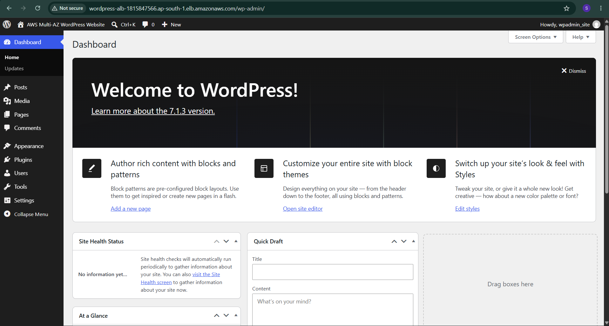
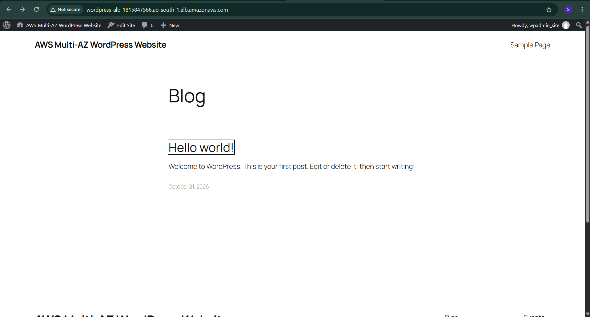
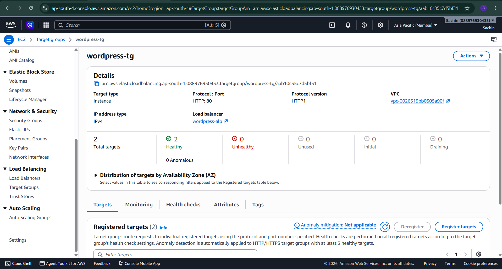
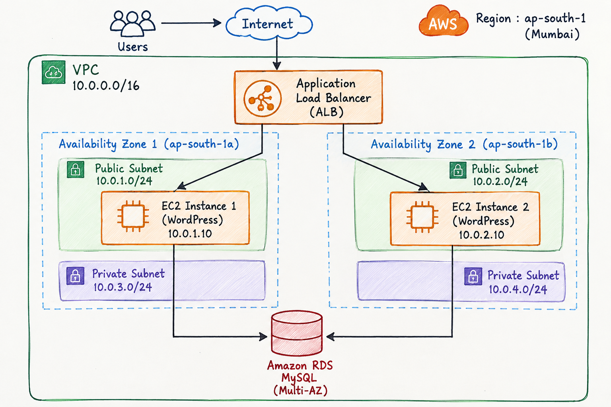

# Multi-AZ WordPress Deployment on AWS

## About the Project

This is my B.Tech IT cloud computing project. I built a WordPress website using AWS to understand how a web application can be hosted using multiple servers.

In this project, I used two EC2 instances to run the web application and an Application Load Balancer to distribute incoming requests between them. I also connected the application to an Amazon RDS MySQL database to store its data.

## Why I Chose This Project

If a website depends on only one server, it may become unavailable when that server fails. I wanted to learn how AWS can help reduce this problem by using multiple web servers and a load balancer.

Through this project, I got practical experience with AWS services and learned how the different components work together.

## AWS Services Used

- **Amazon EC2:** Used to run the web application on two instances.
- **Application Load Balancer:** Distributes incoming requests between the web servers.
- **Amazon RDS MySQL:** Used as the database for WordPress.
- **Amazon VPC:** Used to configure the network and subnets.
- **Security Groups:** Used to control traffic between the load balancer, EC2 instances, and database.
- **AWS Systems Manager Session Manager:** Used to access the EC2 instances through a browser-based terminal.

## Technologies Used

- WordPress
- PHP
- Apache
- MySQL
- Ubuntu Linux
- Amazon Web Services (AWS)

## How I Built the Project

1. Created a VPC with public and private subnets.
2. Configured the internet gateway and routing for the public subnets.
3. Launched two EC2 instances for the web application.
4. Installed Apache, PHP, and the required PHP extensions.
5. Created an RDS MySQL database.
6. Configured security groups to allow the required communication between the services.
7. Created an Application Load Balancer and registered both EC2 instances in its target group.
8. Installed WordPress and configured it to connect to the RDS database.
9. Opened the WordPress website through the load balancer and checked that both EC2 instances were healthy targets.

## Results

I was able to access the WordPress administrator dashboard through the Application Load Balancer. I also verified the database connection during setup and confirmed that both EC2 instances were healthy in the target group.

This helped me understand how a load balancer and multiple web servers can be used to improve the availability of a web application.

**Current limitation:** My RDS database is configured as Single-AZ. I have not configured or verified automatic database failover using RDS Multi-AZ, so database high availability is not yet complete.

## What I Learned

While working on this project, I learned how to configure EC2 instances, set up an Application Load Balancer, connect an application to RDS, configure security groups, and install WordPress on AWS. I also gained experience troubleshooting server and database connection issues.

## Future Improvements

- Configure RDS Multi-AZ, depending on availability and cost.
- Test what happens when one web server becomes unavailable.
- Enable HTTPS for secure access.
- Configure shared storage for WordPress media files.
- Add CloudWatch monitoring and alarms.

## Author

**Sachin S.**

GitHub: [sach2711](https://github.com/sach2711)

---

This project was completed as part of my learning in cloud computing and AWS. AWS resources may incur charges, so they should be monitored and stopped or deleted when no longer required.

---

## Project Screenshots

### 1. WordPress Admin Dashboard

### 2. WordPress Website Through ALB

### 3. EC2 Target Health

### 4. AWS Architecture Diagram

